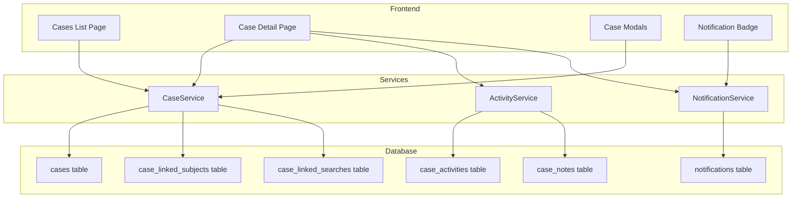

# Design Document: Case Management System

## Overview

The Case Management System extends EagleEye Nigeria Intelligence System with comprehensive investigation case tracking capabilities. This feature enables officers to create formal investigation cases, manage them through a defined workflow, link suspects and search results, maintain detailed activity timelines, and facilitate case assignment with notifications.

The system integrates with the existing Supabase backend, leveraging the current authentication and database infrastructure while adding new tables for cases, case activities, case notes, linked subjects, and notifications.

## Architecture



## Components and Interfaces

### Data Types

```typescript
// Case Status Enum
type CaseStatus = 'OPEN' | 'IN_PROGRESS' | 'UNDER_REVIEW' | 'CLOSED';

// Case Priority Enum
type CasePriority = 'LOW' | 'MEDIUM' | 'HIGH' | 'CRITICAL';

// Activity Type Enum
type ActivityType = 
  | 'CASE_CREATED'
  | 'STATUS_CHANGED'
  | 'OFFICER_ASSIGNED'
  | 'SUBJECT_LINKED'
  | 'SEARCH_LINKED'
  | 'NOTE_ADDED'
  | 'REPORT_GENERATED';

// Case Interface
interface Case {
  id: string;
  caseNumber: string;           // Format: CASE-YYYYMMDD-XXXX
  title: string;
  description: string;
  status: CaseStatus;
  priority: CasePriority;
  ownerId: string;              // Officer who created the case
  assignedOfficerId?: string;   // Officer assigned to investigate
  closingSummary?: string;      // Required when closing
  createdAt: string;
  updatedAt: string;
  lastActivityAt: string;
}

// Case Activity Interface
interface CaseActivity {
  id: string;
  caseId: string;
  activityType: ActivityType;
  officerId: string;
  metadata: Record<string, any>; // Type-specific data
  createdAt: string;
}

// Case Note Interface
interface CaseNote {
  id: string;
  caseId: string;
  officerId: string;
  content: string;
  createdAt: string;
}

// Case Linked Subject Interface
interface CaseLinkedSubject {
  id: string;
  caseId: string;
  suspectFaceToken: string;
  linkedByOfficerId: string;
  matchConfidence: number;
  matchType: 'EXACT' | 'RELATIVE';
  linkedAt: string;
}

// Case Linked Search Interface
interface CaseLinkedSearch {
  id: string;
  caseId: string;
  auditLogId: string;
  linkedByOfficerId: string;
  linkedAt: string;
}

// Notification Interface
interface Notification {
  id: string;
  userId: string;
  type: 'CASE_ASSIGNED' | 'STATUS_CHANGED' | 'NOTE_ADDED';
  caseId: string;
  message: string;
  isRead: boolean;
  createdAt: string;
}
```

### Service Interfaces

```typescript
// CaseService Interface
interface ICaseService {
  // Case CRUD
  createCase(data: CreateCaseInput): Promise<Case>;
  getCase(caseId: string): Promise<CaseWithDetails>;
  getCases(filters: CaseFilters): Promise<PaginatedCases>;
  updateCase(caseId: string, data: UpdateCaseInput): Promise<Case>;
  
  // Status Management
  changeStatus(caseId: string, newStatus: CaseStatus, closingSummary?: string): Promise<Case>;
  getValidTransitions(currentStatus: CaseStatus): CaseStatus[];
  
  // Linking
  linkSubject(caseId: string, subject: LinkSubjectInput): Promise<CaseLinkedSubject>;
  linkSearch(caseId: string, auditLogId: string): Promise<CaseLinkedSearch>;
  unlinkSubject(caseId: string, linkId: string): Promise<void>;
  
  // Assignment
  assignOfficer(caseId: string, officerId: string): Promise<Case>;
  
  // Search
  searchCases(query: string): Promise<Case[]>;
}

// NotificationService Interface
interface INotificationService {
  createNotification(data: CreateNotificationInput): Promise<Notification>;
  getNotifications(userId: string): Promise<Notification[]>;
  getUnreadCount(userId: string): Promise<number>;
  markAsRead(notificationId: string): Promise<void>;
  markAllAsRead(userId: string): Promise<void>;
}

// ActivityService Interface
interface IActivityService {
  logActivity(caseId: string, type: ActivityType, metadata: Record<string, any>): Promise<CaseActivity>;
  getActivities(caseId: string): Promise<CaseActivity[]>;
  addNote(caseId: string, content: string): Promise<CaseNote>;
  getNotes(caseId: string): Promise<CaseNote[]>;
  getTimeline(caseId: string): Promise<TimelineEntry[]>;
}
```

### UI Components

```typescript
// Pages
- CasesListPage: Main case listing with filters and search
- CaseDetailPage: Full case view with tabs for details, subjects, timeline

// Components
- CaseCard: Summary card for case list
- CaseForm: Create/edit case form
- CaseStatusBadge: Color-coded status indicator
- CasePriorityBadge: Priority indicator
- CaseTimeline: Activity and notes timeline
- LinkedSubjectCard: Subject card with case context
- AddToCaseModal: Modal for linking subjects to cases
- AssignOfficerModal: Modal for case assignment
- NotificationBell: Header notification indicator
- NotificationDropdown: Notification list dropdown
```

## Data Models

### Database Schema

```sql
-- Cases Table
CREATE TABLE cases (
  id UUID PRIMARY KEY DEFAULT gen_random_uuid(),
  case_number VARCHAR(20) UNIQUE NOT NULL,
  title VARCHAR(255) NOT NULL,
  description TEXT,
  status VARCHAR(20) NOT NULL DEFAULT 'OPEN',
  priority VARCHAR(20) NOT NULL DEFAULT 'MEDIUM',
  owner_id VARCHAR(50) NOT NULL,
  assigned_officer_id VARCHAR(50),
  closing_summary TEXT,
  created_at TIMESTAMPTZ DEFAULT NOW(),
  updated_at TIMESTAMPTZ DEFAULT NOW(),
  last_activity_at TIMESTAMPTZ DEFAULT NOW()
);

-- Case Activities Table
CREATE TABLE case_activities (
  id UUID PRIMARY KEY DEFAULT gen_random_uuid(),
  case_id UUID NOT NULL REFERENCES cases(id) ON DELETE CASCADE,
  activity_type VARCHAR(50) NOT NULL,
  officer_id VARCHAR(50) NOT NULL,
  metadata JSONB DEFAULT '{}',
  created_at TIMESTAMPTZ DEFAULT NOW()
);

-- Case Notes Table
CREATE TABLE case_notes (
  id UUID PRIMARY KEY DEFAULT gen_random_uuid(),
  case_id UUID NOT NULL REFERENCES cases(id) ON DELETE CASCADE,
  officer_id VARCHAR(50) NOT NULL,
  content TEXT NOT NULL,
  created_at TIMESTAMPTZ DEFAULT NOW()
);

-- Case Linked Subjects Table
CREATE TABLE case_linked_subjects (
  id UUID PRIMARY KEY DEFAULT gen_random_uuid(),
  case_id UUID NOT NULL REFERENCES cases(id) ON DELETE CASCADE,
  suspect_face_token VARCHAR(100) NOT NULL,
  linked_by_officer_id VARCHAR(50) NOT NULL,
  match_confidence DECIMAL(5,2),
  match_type VARCHAR(20),
  linked_at TIMESTAMPTZ DEFAULT NOW(),
  UNIQUE(case_id, suspect_face_token)
);

-- Case Linked Searches Table
CREATE TABLE case_linked_searches (
  id UUID PRIMARY KEY DEFAULT gen_random_uuid(),
  case_id UUID NOT NULL REFERENCES cases(id) ON DELETE CASCADE,
  audit_log_id VARCHAR(100) NOT NULL,
  linked_by_officer_id VARCHAR(50) NOT NULL,
  linked_at TIMESTAMPTZ DEFAULT NOW(),
  UNIQUE(case_id, audit_log_id)
);

-- Notifications Table
CREATE TABLE notifications (
  id UUID PRIMARY KEY DEFAULT gen_random_uuid(),
  user_id VARCHAR(50) NOT NULL,
  type VARCHAR(50) NOT NULL,
  case_id UUID REFERENCES cases(id) ON DELETE CASCADE,
  message TEXT NOT NULL,
  is_read BOOLEAN DEFAULT FALSE,
  created_at TIMESTAMPTZ DEFAULT NOW()
);

-- Indexes
CREATE INDEX idx_cases_status ON cases(status);
CREATE INDEX idx_cases_priority ON cases(priority);
CREATE INDEX idx_cases_owner ON cases(owner_id);
CREATE INDEX idx_cases_assigned ON cases(assigned_officer_id);
CREATE INDEX idx_cases_last_activity ON cases(last_activity_at DESC);
CREATE INDEX idx_activities_case ON case_activities(case_id);
CREATE INDEX idx_notes_case ON case_notes(case_id);
CREATE INDEX idx_linked_subjects_case ON case_linked_subjects(case_id);
CREATE INDEX idx_notifications_user ON notifications(user_id, is_read);
```

## Correctness Properties

*A property is a characteristic or behavior that should hold true across all valid executions of a system-essentially, a formal statement about what the system should do. Properties serve as the bridge between human-readable specifications and machine-verifiable correctness guarantees.*

Based on the prework analysis, the following correctness properties have been identified:

### Property 1: Case number format and uniqueness
*For any* case creation with valid input, the generated case number SHALL match the format "CASE-YYYYMMDD-XXXX" where YYYY is the year, MM is the month, DD is the day, and XXXX is a unique 4-character alphanumeric sequence, AND no two cases SHALL have the same case number.
**Validates: Requirements 1.2**

### Property 2: Case creation initializes correctly
*For any* case creation, the resulting case SHALL have status set to OPEN, owner_id set to the creating officer's ID, AND an activity log entry of type CASE_CREATED SHALL be created with the correct timestamp and officer ID.
**Validates: Requirements 1.3, 1.4**

### Property 3: Case validation rejects invalid input
*For any* case creation attempt with empty title or empty description, the system SHALL reject the creation and return a validation error.
**Validates: Requirements 1.5**

### Property 4: Status transitions follow valid workflow
*For any* case status change attempt, the system SHALL only allow transitions that follow the workflow: OPEN → IN_PROGRESS, IN_PROGRESS → UNDER_REVIEW, UNDER_REVIEW → CLOSED. All other transitions SHALL be rejected.
**Validates: Requirements 2.2**

### Property 5: Status changes create activity logs
*For any* successful status change, an activity log entry SHALL be created containing the previous status, new status, timestamp, and officer ID.
**Validates: Requirements 2.3**

### Property 6: Closing requires summary
*For any* status change to CLOSED, the system SHALL require a non-empty closing summary. Attempts to close without a summary SHALL be rejected.
**Validates: Requirements 2.4**

### Property 7: Closed cases are immutable for non-commanders
*For any* modification attempt on a CLOSED case by a user with role OFFICER, the system SHALL reject the modification. Only users with role CHIEF_COMMANDER SHALL be able to modify closed cases.
**Validates: Requirements 2.5**

### Property 8: Subject linking stores complete data
*For any* subject linked to a case, the link record SHALL contain the case ID, suspect face token, linking officer ID, match confidence, match type, and timestamp.
**Validates: Requirements 3.3**

### Property 9: Duplicate subject linking is prevented
*For any* attempt to link a subject that is already linked to the same case, the system SHALL reject the operation and indicate the subject is already linked.
**Validates: Requirements 3.6**

### Property 10: Timeline is chronologically ordered
*For any* case timeline retrieval, the returned entries SHALL be sorted by timestamp in descending order (most recent first).
**Validates: Requirements 4.1**

### Property 11: Notes contain required fields
*For any* note added to a case, the stored note SHALL contain the case ID, officer ID, content, and timestamp.
**Validates: Requirements 4.2**

### Property 12: Assignment creates notifications
*For any* case assignment, a notification SHALL be created for the assigned officer with type CASE_ASSIGNED and the correct case ID.
**Validates: Requirements 5.2, 5.3**

### Property 13: Status changes notify relevant parties
*For any* case status change, notifications SHALL be created for both the case owner and the assigned officer (if different from the actor).
**Validates: Requirements 5.4**

### Property 14: Case filters return matching results
*For any* case list query with filters, all returned cases SHALL match ALL specified filter criteria (status, priority, assigned officer, date range).
**Validates: Requirements 5.5, 6.3**

### Property 15: Case search returns relevant results
*For any* case search query, all returned cases SHALL contain the search term in either the case number, title, or linked subject name.
**Validates: Requirements 6.2**

### Property 16: Default sort is by last activity
*For any* case list retrieval without explicit sort, the cases SHALL be sorted by last_activity_at in descending order.
**Validates: Requirements 6.5**

### Property 17: Report contains all required sections
*For any* case report generation, the output SHALL contain the case details, all linked subjects, the complete timeline, and all notes.
**Validates: Requirements 7.2**

### Property 18: Report includes official header
*For any* case report generation, the output SHALL include the EagleEye header with "FEDERAL REPUBLIC OF NIGERIA", agency name, and "CONFIDENTIAL" classification marking.
**Validates: Requirements 7.4**

### Property 19: Report generation is logged
*For any* case report generation, an activity log entry of type REPORT_GENERATED SHALL be created.
**Validates: Requirements 7.5**

## Error Handling

| Error Scenario | Error Code | User Message | Recovery Action |
|----------------|------------|--------------|-----------------|
| Case not found | CASE_NOT_FOUND | Case does not exist or has been deleted | Redirect to case list |
| Invalid status transition | INVALID_TRANSITION | Cannot change status from {current} to {target} | Show valid transitions |
| Missing closing summary | CLOSING_SUMMARY_REQUIRED | A closing summary is required to close this case | Focus on summary field |
| Duplicate subject link | SUBJECT_ALREADY_LINKED | This subject is already linked to this case | Show existing link |
| Unauthorized modification | UNAUTHORIZED_MODIFICATION | You do not have permission to modify this case | Show read-only view |
| Validation error | VALIDATION_ERROR | {field} is required | Highlight invalid fields |
| Database error | DATABASE_ERROR | Unable to save changes. Please try again | Retry operation |

## Testing Strategy

### Dual Testing Approach

This feature will use both unit tests and property-based tests to ensure comprehensive coverage:

**Unit Tests** will cover:
- UI component rendering and interactions
- Service method edge cases
- Error handling scenarios
- Integration between components

**Property-Based Tests** will use **fast-check** library to verify:
- Case number generation format and uniqueness
- Status transition validation
- Data completeness on creation and linking
- Filter and search correctness
- Timeline ordering

### Property-Based Testing Configuration

```typescript
import fc from 'fast-check';

// Configure minimum 100 iterations per property
fc.configureGlobal({ numRuns: 100 });
```

### Test File Structure

```
services/
  caseService.ts
  caseService.test.ts        # Unit tests
  caseService.property.test.ts  # Property-based tests
  notificationService.ts
  notificationService.test.ts
  activityService.ts
  activityService.test.ts
```

Each property-based test will be tagged with a comment referencing the correctness property:
```typescript
// **Feature: case-management-system, Property 1: Case number format and uniqueness**
```
