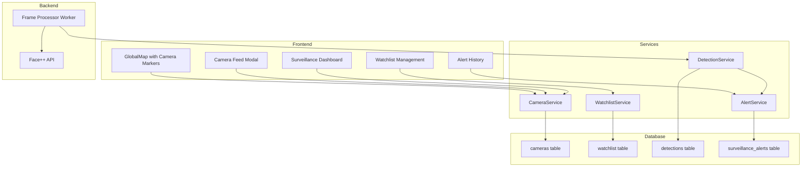

# Design Document: Live Surveillance Monitoring System

## Overview

The Live Surveillance Monitoring System extends EagleEye Nigeria Intelligence System with real-time camera monitoring capabilities. This feature enables officers to view live camera feeds placed on the map, manage a watchlist of Persons of Interest (POI), monitor multiple feeds through a surveillance dashboard, and receive automatic alerts when POI are detected through facial recognition.

The system integrates with the existing GlobalMap, Face++ recognition engine, and Supabase backend to provide a comprehensive surveillance solution.

## Architecture



## Components and Interfaces

### Data Types

```typescript
// Camera Status Enum
type CameraStatus = 'ONLINE' | 'OFFLINE' | 'RECORDING' | 'MAINTENANCE';

// POI Priority Enum
type POIPriority = 'CRITICAL' | 'HIGH' | 'MEDIUM' | 'LOW';

// Alert Status Enum
type AlertStatus = 'UNREAD' | 'READ' | 'ACKNOWLEDGED' | 'LINKED_TO_CASE';

// Camera Interface
interface Camera {
  id: string;
  name: string;
  description: string;
  streamUrl: string;
  coordinates: { lat: number; lng: number };
  status: CameraStatus;
  lastOnline: string;
  createdAt: string;
  updatedAt: string;
}

// Watchlist POI Interface
interface WatchlistPOI {
  id: string;
  faceToken: string;
  name: string;
  imageUrl: string;
  priority: POIPriority;
  caseId?: string;
  notes?: string;
  isActive: boolean;
  createdAt: string;
  createdBy: string;
}

// Detection Interface
interface Detection {
  id: string;
  cameraId: string;
  poiId: string;
  snapshotUrl: string;
  confidence: number;
  boundingBox: { x: number; y: number; width: number; height: number };
  detectedAt: string;
  metadata: Record<string, any>;
}

// Surveillance Alert Interface
interface SurveillanceAlert {
  id: string;
  detectionId: string;
  poiId: string;
  cameraId: string;
  status: AlertStatus;
  acknowledgedBy?: string;
  acknowledgedAt?: string;
  linkedCaseId?: string;
  createdAt: string;
}
```

### Service Interfaces

```typescript
// CameraService Interface
interface ICameraService {
  getCameras(): Promise<Camera[]>;
  getCamera(cameraId: string): Promise<Camera>;
  createCamera(data: CreateCameraInput): Promise<Camera>;
  updateCamera(cameraId: string, data: UpdateCameraInput): Promise<Camera>;
  deleteCamera(cameraId: string): Promise<void>;
  updateCameraStatus(cameraId: string, status: CameraStatus): Promise<Camera>;
  validateStreamUrl(url: string): Promise<boolean>;
}

// WatchlistService Interface
interface IWatchlistService {
  getPOIs(): Promise<WatchlistPOI[]>;
  getPOI(poiId: string): Promise<WatchlistPOI>;
  addPOI(data: AddPOIInput): Promise<WatchlistPOI>;
  updatePOI(poiId: string, data: UpdatePOIInput): Promise<WatchlistPOI>;
  removePOI(poiId: string): Promise<void>;
  getDetectionHistory(poiId: string): Promise<Detection[]>;
}

// DetectionService Interface
interface IDetectionService {
  processFrame(cameraId: string, frameData: string): Promise<Detection[]>;
  getDetections(filters: DetectionFilters): Promise<Detection[]>;
  getDetection(detectionId: string): Promise<Detection>;
  linkDetectionToCase(detectionId: string, caseId: string): Promise<void>;
}

// AlertService Interface
interface IAlertService {
  getAlerts(filters: AlertFilters): Promise<SurveillanceAlert[]>;
  getUnreadCount(): Promise<number>;
  acknowledgeAlert(alertId: string, officerId: string): Promise<void>;
  linkAlertToCase(alertId: string, caseId: string): Promise<void>;
}
```

### UI Components

```typescript
// Pages
- SurveillanceDashboard: Multi-screen camera feed monitoring
- WatchlistPage: POI management interface
- DetectionHistoryPage: Historical detection records

// Components
- CameraMarker: Map marker for camera locations
- CameraFeedModal: Live feed viewer with controls
- CameraGrid: Multi-feed grid layout (2x2, 3x3, 4x4)
- CameraFeedCard: Individual feed in grid
- POICard: Watchlist person card
- AddPOIModal: Add person to watchlist
- DetectionAlertPopup: Real-time alert notification
- DetectionCard: Detection history item
- CameraManagementModal: Add/edit camera settings
```

## Data Models

### Database Schema

```sql
-- Cameras Table
CREATE TABLE cameras (
  id UUID PRIMARY KEY DEFAULT gen_random_uuid(),
  name VARCHAR(100) NOT NULL,
  description TEXT,
  stream_url VARCHAR(500) NOT NULL,
  lat DECIMAL(10, 8) NOT NULL,
  lng DECIMAL(11, 8) NOT NULL,
  status VARCHAR(20) NOT NULL DEFAULT 'OFFLINE',
  last_online TIMESTAMPTZ,
  created_at TIMESTAMPTZ DEFAULT NOW(),
  updated_at TIMESTAMPTZ DEFAULT NOW()
);

-- Watchlist Table
CREATE TABLE watchlist (
  id UUID PRIMARY KEY DEFAULT gen_random_uuid(),
  face_token VARCHAR(100) NOT NULL,
  name VARCHAR(100) NOT NULL,
  image_url TEXT,
  priority VARCHAR(20) NOT NULL DEFAULT 'MEDIUM',
  case_id UUID REFERENCES cases(id),
  notes TEXT,
  is_active BOOLEAN DEFAULT TRUE,
  created_at TIMESTAMPTZ DEFAULT NOW(),
  created_by VARCHAR(50) NOT NULL
);

-- Detections Table
CREATE TABLE detections (
  id UUID PRIMARY KEY DEFAULT gen_random_uuid(),
  camera_id UUID NOT NULL REFERENCES cameras(id) ON DELETE CASCADE,
  poi_id UUID NOT NULL REFERENCES watchlist(id) ON DELETE CASCADE,
  snapshot_url TEXT NOT NULL,
  confidence DECIMAL(5, 2) NOT NULL,
  bounding_box JSONB,
  detected_at TIMESTAMPTZ DEFAULT NOW(),
  metadata JSONB DEFAULT '{}'
);

-- Surveillance Alerts Table
CREATE TABLE surveillance_alerts (
  id UUID PRIMARY KEY DEFAULT gen_random_uuid(),
  detection_id UUID NOT NULL REFERENCES detections(id) ON DELETE CASCADE,
  poi_id UUID NOT NULL REFERENCES watchlist(id) ON DELETE CASCADE,
  camera_id UUID NOT NULL REFERENCES cameras(id) ON DELETE CASCADE,
  status VARCHAR(20) NOT NULL DEFAULT 'UNREAD',
  acknowledged_by VARCHAR(50),
  acknowledged_at TIMESTAMPTZ,
  linked_case_id UUID REFERENCES cases(id),
  created_at TIMESTAMPTZ DEFAULT NOW()
);

-- Indexes
CREATE INDEX idx_cameras_status ON cameras(status);
CREATE INDEX idx_cameras_coords ON cameras(lat, lng);
CREATE INDEX idx_watchlist_active ON watchlist(is_active);
CREATE INDEX idx_watchlist_priority ON watchlist(priority);
CREATE INDEX idx_detections_camera ON detections(camera_id);
CREATE INDEX idx_detections_poi ON detections(poi_id);
CREATE INDEX idx_detections_time ON detections(detected_at DESC);
CREATE INDEX idx_alerts_status ON surveillance_alerts(status);
CREATE INDEX idx_alerts_created ON surveillance_alerts(created_at DESC);
```

## Correctness Properties

*A property is a characteristic or behavior that should hold true across all valid executions of a system-essentially, a formal statement about what the system should do. Properties serve as the bridge between human-readable specifications and machine-verifiable correctness guarantees.*

### Property 1: Camera markers reflect database state
*For any* camera in the database with status ONLINE, the GlobalMap SHALL display a camera marker at the correct coordinates with a green status indicator.
**Validates: Requirements 1.1, 1.2, 1.4**

### Property 2: Camera feed modal displays correct stream
*For any* camera marker click, the opened modal SHALL display the stream from the URL associated with that camera ID in the database.
**Validates: Requirements 2.1, 2.2**

### Property 3: Watchlist POI registration
*For any* POI added to the watchlist, the face token SHALL be registered with the facial recognition engine AND stored in the database with all required fields.
**Validates: Requirements 4.2, 4.3**

### Property 4: Detection creates alert
*For any* facial recognition match with confidence above the configured threshold, a detection record SHALL be created AND a corresponding alert SHALL be generated.
**Validates: Requirements 6.1, 8.3**

### Property 5: Alert acknowledgment is logged
*For any* alert acknowledgment action, the alert status SHALL change to ACKNOWLEDGED AND the acknowledging officer ID and timestamp SHALL be recorded.
**Validates: Requirements 6.5**

### Property 6: Detection history filtering
*For any* detection history query with filters, all returned detections SHALL match ALL specified filter criteria (POI, camera, date range, confidence threshold).
**Validates: Requirements 7.2**

### Property 7: Camera deletion cascades
*For any* camera deletion, all associated detections and alerts SHALL be removed from the database.
**Validates: Requirements 3.4**

### Property 8: Watchlist removal stops monitoring
*For any* POI removed from the watchlist, the is_active flag SHALL be set to FALSE AND no new detections SHALL be created for that POI.
**Validates: Requirements 4.4**

## Error Handling

| Error Scenario | Error Code | User Message | Recovery Action |
|----------------|------------|--------------|-----------------|
| Camera offline | CAMERA_OFFLINE | Camera is currently offline | Show last known timestamp |
| Stream connection failed | STREAM_ERROR | Unable to connect to camera feed | Retry connection, show offline state |
| Invalid stream URL | INVALID_STREAM_URL | The stream URL is not accessible | Prompt to verify URL |
| Face detection failed | DETECTION_ERROR | Unable to process frame | Log error, continue processing |
| POI already in watchlist | DUPLICATE_POI | This person is already in the watchlist | Show existing entry |
| Camera not found | CAMERA_NOT_FOUND | Camera does not exist | Redirect to camera list |
| Unauthorized access | UNAUTHORIZED | You do not have permission | Show read-only view |

## Testing Strategy

### Dual Testing Approach

**Unit Tests** will cover:
- Camera CRUD operations
- Watchlist management
- Alert status transitions
- UI component rendering

**Property-Based Tests** will use **fast-check** library to verify:
- Camera marker placement accuracy
- Detection filtering correctness
- Alert creation from detections
- Cascade deletion behavior

### Test File Structure

```
services/
  cameraService.ts
  cameraService.test.ts
  cameraService.property.test.ts
  watchlistService.ts
  watchlistService.test.ts
  detectionService.ts
  detectionService.property.test.ts
  alertService.ts
  alertService.test.ts
```

Each property-based test will be tagged with a comment referencing the correctness property:
```typescript
// **Feature: live-surveillance-system, Property 1: Camera markers reflect database state**
```
