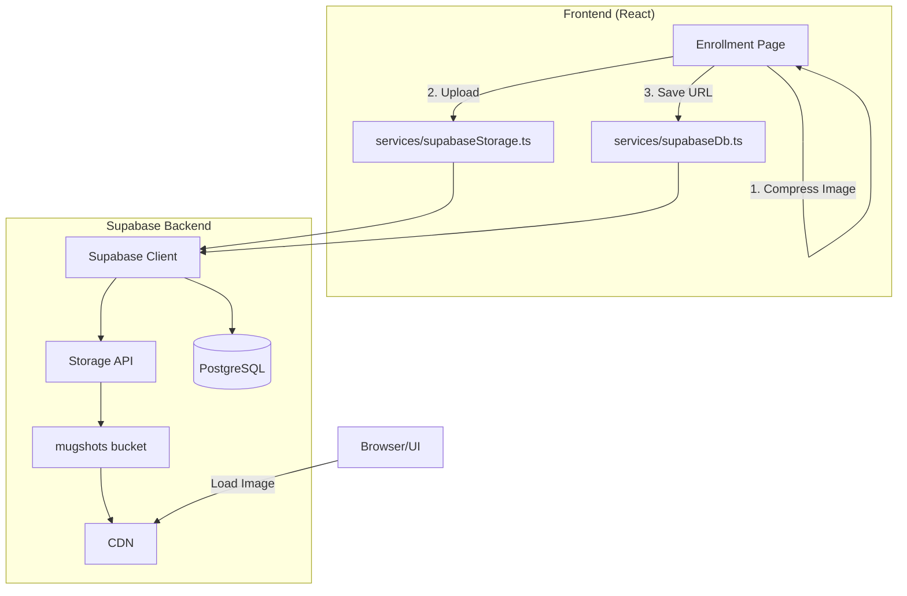
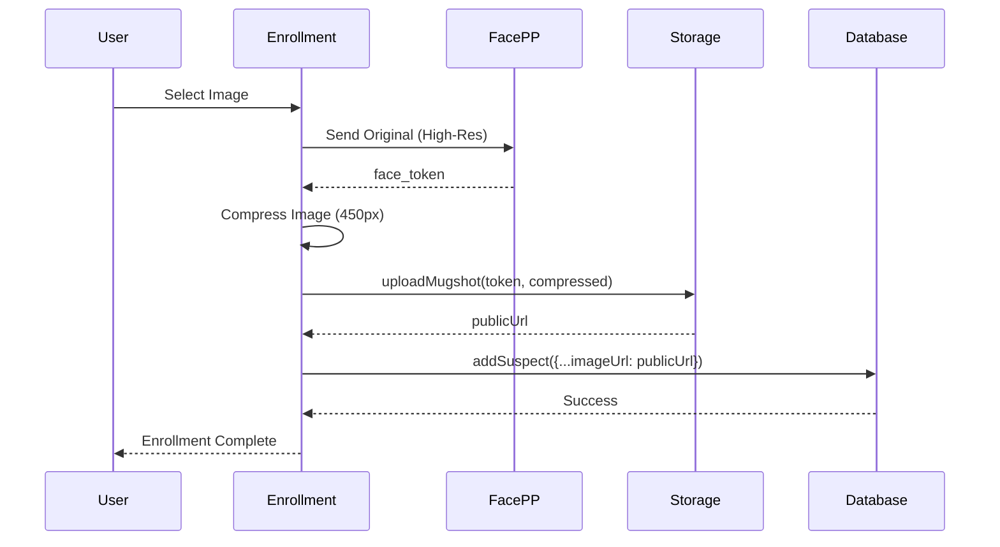

# Design Document: Supabase Image Storage

## Overview

This design describes the implementation of Supabase Storage for mugshot images in the EagleEye system. The current approach stores images as base64-encoded data URLs directly in the database, which is inefficient and limits scalability. This feature migrates image storage to Supabase Storage buckets, providing proper cloud-based file storage with CDN delivery.

**Supabase Project Details:**
- Project ID: `ahpcvrkcihxnudbujxdq`
- URL: `https://your-project.supabase.co`
- Storage Bucket: `mugshots`

## Architecture



The architecture adds a new storage service layer that handles image uploads to Supabase Storage. The Enrollment page compresses images before upload, stores them in the `mugshots` bucket, and saves the resulting public URL to the suspect's `imageUrl` field.

## Components and Interfaces

### 1. Supabase Storage Service

A new service module for image storage operations:

```typescript
// services/supabaseStorage.ts
interface IStorageService {
  // Ensure bucket exists, create if not
  ensureBucket(): Promise<void>;
  
  // Upload image and return public URL
  uploadMugshot(faceToken: string, image: File | Blob | string): Promise<string>;
  
  // Delete image from storage
  deleteMugshot(faceToken: string): Promise<void>;
  
  // Get public URL for a face token
  getPublicUrl(faceToken: string): string;
}
```

### 2. Image Compression Utility

The existing `compressImage` function in Enrollment.tsx will be extracted to a utility:

```typescript
// utils/imageCompression.ts
export async function compressImage(
  file: File | Blob,
  maxWidth: number = 450,
  quality: number = 0.9
): Promise<Blob>;
```

### 3. Updated Enrollment Flow



## Data Models

### Storage Structure

```
mugshots/
├── {face_token_1}.jpg
├── {face_token_2}.jpg
└── ...
```

### Filename Convention

| Component | Format | Example |
|-----------|--------|---------|
| Bucket | `mugshots` | `mugshots` |
| Filename | `{face_token}.jpg` | `abc123xyz.jpg` |
| Full Path | `mugshots/{face_token}.jpg` | `mugshots/abc123xyz.jpg` |

### Public URL Format

```
https://{project_id}.supabase.co/storage/v1/object/public/mugshots/{face_token}.jpg
```

Example:
```
https://your-project.supabase.co/storage/v1/object/public/mugshots/abc123xyz.jpg
```

## Correctness Properties

*A property is a characteristic or behavior that should hold true across all valid executions of a system-essentially, a formal statement about what the system should do. Properties serve as the bridge between human-readable specifications and machine-verifiable correctness guarantees.*

Based on the prework analysis, the following properties must hold:

### Property 1: Filename Generation Consistency
*For any* valid face_token string, the generated filename should follow the exact format `{face_token}.jpg`.
**Validates: Requirements 1.3, 4.3**

### Property 2: Public URL Format Validity
*For any* successfully uploaded image, the returned public URL should be a valid Supabase storage URL containing the bucket name 'mugshots' and the face_token-based filename.
**Validates: Requirements 1.4, 2.3, 3.3, 5.1**

### Property 3: Image Compression Bounds
*For any* image with width greater than 450 pixels, after compression the resulting image width should be exactly 450 pixels while maintaining aspect ratio.
**Validates: Requirements 2.1**

### Property 4: Input Format Flexibility
*For any* valid image input (File object, Blob, or base64 string), the upload function should successfully process and store the image.
**Validates: Requirements 4.2**

### Property 5: Upload Round-Trip Consistency
*For any* image uploaded to storage, retrieving it via the public URL should return valid image data.
**Validates: Requirements 1.4, 5.1**

## Error Handling

### Storage Errors
- Bucket not found: Auto-create bucket with public access
- Upload failure: Throw `StorageError` with details, prevent suspect creation
- Delete failure: Log warning but don't block update operation
- Invalid input: Throw `StorageError` indicating invalid image format

### Error Response Format
```typescript
class StorageError extends Error {
  constructor(
    message: string,
    public code: string,
    public details?: string
  ) {
    super(message);
    this.name = 'StorageError';
  }
}
```

## Testing Strategy

### Property-Based Testing Library
**fast-check** will be used for property-based testing in TypeScript.

### Unit Tests
- Test filename generation with various face_token formats
- Test URL construction
- Test image compression with different input sizes
- Test error handling for invalid inputs

### Property-Based Tests
Each correctness property will be implemented as a property-based test using fast-check:

1. **Filename Generation**: Generate arbitrary face_token strings, verify filename format
2. **URL Format**: Generate arbitrary tokens, verify URL structure
3. **Image Compression**: Generate images of various sizes, verify compression bounds
4. **Input Flexibility**: Generate File, Blob, and base64 inputs, verify all succeed
5. **Round-Trip**: Upload and retrieve, verify data integrity

### Test Configuration
- Minimum 100 iterations per property test
- Each test tagged with: `**Feature: supabase-image-storage, Property {N}: {description}**`

### Integration Tests
- Verify bucket creation on first use
- Verify image upload and retrieval flow
- Verify old image deletion on update

