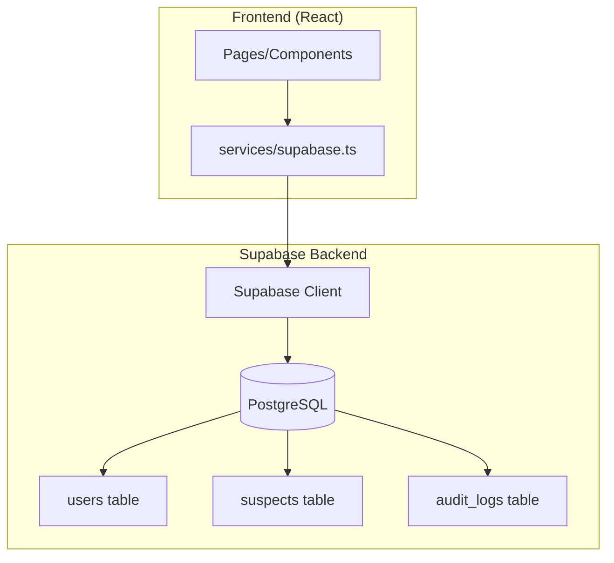

# Design Document: Supabase Migration

## Overview

This design describes the migration of EagleEye's data persistence layer from browser localStorage to Supabase. The migration preserves the existing application interface while enabling cloud-based storage, multi-device synchronization, and proper relational data management.

**Supabase Project Details:**
- Project ID: `ahpcvrkcihxnudbujxdq`
- URL: `https://your-project.supabase.co`
- Region: `eu-central-1`

## Architecture



The architecture replaces the localStorage-based `DatabaseService` with a Supabase-backed service that maintains the same interface. This allows existing components to work with minimal changes.

## Components and Interfaces

### 1. Supabase Client Configuration

A new configuration module that initializes the Supabase client:

```typescript
// services/supabase.ts
import { createClient, SupabaseClient } from '@supabase/supabase-js';

const SUPABASE_URL = 'https://your-project.supabase.co';
const SUPABASE_ANON_KEY = 'eyJhbGciOiJIUzI1NiIsInR5cCI6IkpXVCJ9...';

export const supabase: SupabaseClient = createClient(SUPABASE_URL, SUPABASE_ANON_KEY);
```

### 2. Database Service Interface

The new service maintains API compatibility with the existing `DatabaseService`:

```typescript
interface IDatabaseService {
  // User Operations
  getUsers(): Promise<User[]>;
  addUser(user: User): Promise<void>;
  bulkCreateOfficers(count: number): Promise<void>;
  
  // Suspect Operations
  getSuspects(): Promise<Suspect[]>;
  addSuspect(suspect: Suspect): Promise<void>;
  updateSuspect(suspect: Suspect): Promise<void>;
  updateSuspectStatus(faceToken: string, status: Suspect['status']): Promise<void>;
  
  // Audit Operations
  getAuditLogs(): Promise<AuditLog[]>;
  logSearch(log: AuditLog): Promise<void>;
}
```

**Key Change:** All methods become async and return Promises instead of synchronous values.

### 3. Case Conversion Utilities

Utilities for converting between TypeScript camelCase and PostgreSQL snake_case:

```typescript
// utils/caseConversion.ts
export function toSnakeCase(obj: Record<string, any>): Record<string, any>;
export function toCamelCase(obj: Record<string, any>): Record<string, any>;
```

## Data Models

### Database Schema

#### users table
| Column | Type | Constraints |
|--------|------|-------------|
| id | TEXT | PRIMARY KEY |
| username | TEXT | NOT NULL, UNIQUE |
| role | TEXT | NOT NULL, CHECK (role IN ('CHIEF_COMMANDER', 'OFFICER')) |
| created_at | TIMESTAMPTZ | NOT NULL, DEFAULT NOW() |

#### suspects table
| Column | Type | Constraints |
|--------|------|-------------|
| face_token | TEXT | PRIMARY KEY |
| name | TEXT | NOT NULL |
| crime | TEXT | NOT NULL |
| nin | TEXT | NOT NULL |
| location | TEXT | NOT NULL |
| image_url | TEXT | NOT NULL |
| source_url | TEXT | NOT NULL |
| is_relative_to_id | TEXT | REFERENCES suspects(face_token) |
| coordinates_lat | NUMERIC | |
| coordinates_lng | NUMERIC | |
| dob | TEXT | |
| gender | TEXT | CHECK (gender IN ('MALE', 'FEMALE', 'OTHER')) |
| physical_marks | TEXT | |
| status | TEXT | CHECK (status IN ('WANTED', 'IN_CUSTODY', 'CLEARED', 'DECEASED')) |
| notes | TEXT | |

#### audit_logs table
| Column | Type | Constraints |
|--------|------|-------------|
| log_id | TEXT | PRIMARY KEY |
| officer_id | TEXT | NOT NULL, REFERENCES users(id) |
| search_image_path | TEXT | NOT NULL |
| timestamp | TIMESTAMPTZ | NOT NULL |
| result_count | INTEGER | NOT NULL |
| search_type | TEXT | NOT NULL, CHECK (search_type IN ('LOCAL', 'DEEP_WEB')) |

### TypeScript to Database Mapping

| TypeScript Property | Database Column |
|---------------------|-----------------|
| faceToken | face_token |
| imageUrl | image_url |
| sourceUrl | source_url |
| isRelativeToId | is_relative_to_id |
| coordinates.lat | coordinates_lat |
| coordinates.lng | coordinates_lng |
| physicalMarks | physical_marks |
| createdAt | created_at |
| logId | log_id |
| officerId | officer_id |
| searchImagePath | search_image_path |
| resultCount | result_count |
| searchType | search_type |

## Correctness Properties

*A property is a characteristic or behavior that should hold true across all valid executions of a system-essentially, a formal statement about what the system should do. Properties serve as the bridge between human-readable specifications and machine-verifiable correctness guarantees.*

Based on the prework analysis, the following properties must hold:

### Property 1: User Round-Trip Consistency
*For any* valid User object, adding it to the database and then retrieving all users should return a collection containing that user with all fields intact.
**Validates: Requirements 1.2, 1.4**

### Property 2: Bulk Officer Creation Count
*For any* positive integer N, calling bulkCreateOfficers(N) should increase the total user count by exactly N, and all new users should have role 'OFFICER'.
**Validates: Requirements 1.3**

### Property 3: Suspect Round-Trip Consistency
*For any* valid Suspect object (including optional coordinates), adding it to the database and then retrieving all suspects should return a collection containing that suspect with all fields intact.
**Validates: Requirements 2.2, 2.5**

### Property 4: Suspect Update Persistence
*For any* existing suspect and any valid field updates, calling updateSuspect should result in the suspect having the updated values when retrieved.
**Validates: Requirements 2.3**

### Property 5: Status Update Isolation
*For any* existing suspect and any valid status value, calling updateSuspectStatus should change only the status field while preserving all other fields.
**Validates: Requirements 2.4**

### Property 6: Audit Log Round-Trip Consistency
*For any* valid AuditLog object with a valid officer_id, logging it and then retrieving audit logs should return a collection containing that log with all fields intact.
**Validates: Requirements 3.1**

### Property 7: Audit Log Ordering
*For any* set of audit logs with distinct timestamps, getAuditLogs should return them in descending timestamp order (newest first).
**Validates: Requirements 3.2**

### Property 8: Case Conversion Round-Trip
*For any* object with camelCase keys, converting to snake_case and back to camelCase should produce an equivalent object.
**Validates: Requirements 4.4, 4.5**

## Error Handling

### Database Errors
- Connection failures: Throw descriptive error with retry suggestion
- Constraint violations: Throw error indicating which constraint failed (unique, foreign key, check)
- Not found: Return empty array for queries, throw for updates on non-existent records

### Error Response Format
```typescript
class DatabaseError extends Error {
  constructor(
    message: string,
    public code: string,
    public details?: string
  ) {
    super(message);
  }
}
```

## Testing Strategy

### Property-Based Testing Library
**fast-check** will be used for property-based testing in TypeScript.

### Unit Tests
- Test Supabase client initialization
- Test case conversion utilities with specific examples
- Test error handling for invalid inputs

### Property-Based Tests
Each correctness property will be implemented as a property-based test using fast-check:

1. **User Round-Trip**: Generate arbitrary valid users, insert, retrieve, verify equality
2. **Bulk Creation**: Generate arbitrary counts (1-100), verify count increase
3. **Suspect Round-Trip**: Generate arbitrary suspects with optional fields, verify persistence
4. **Suspect Update**: Generate existing suspect + updates, verify changes applied
5. **Status Update Isolation**: Generate suspect + new status, verify only status changed
6. **Audit Log Round-Trip**: Generate valid audit logs, verify persistence
7. **Audit Log Ordering**: Generate multiple logs with different timestamps, verify order
8. **Case Conversion**: Generate arbitrary objects, verify round-trip equality

### Test Configuration
- Minimum 100 iterations per property test
- Each test tagged with: `**Feature: supabase-migration, Property {N}: {description}**`

### Integration Tests
- Verify migrations apply successfully
- Verify seed data is inserted correctly
- Verify existing components work with new service
